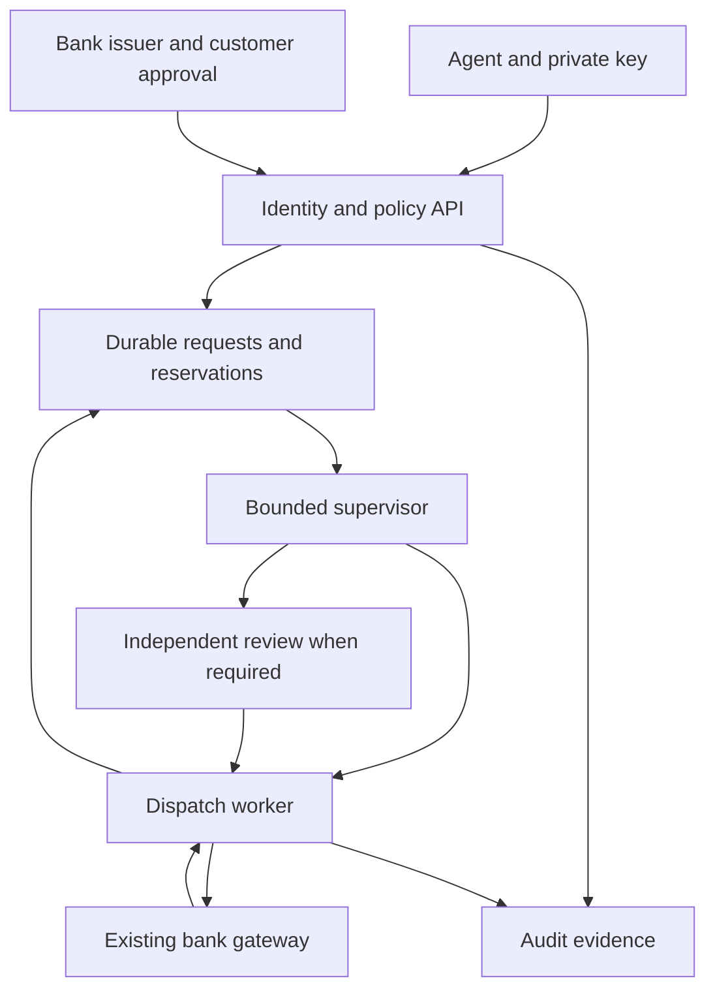
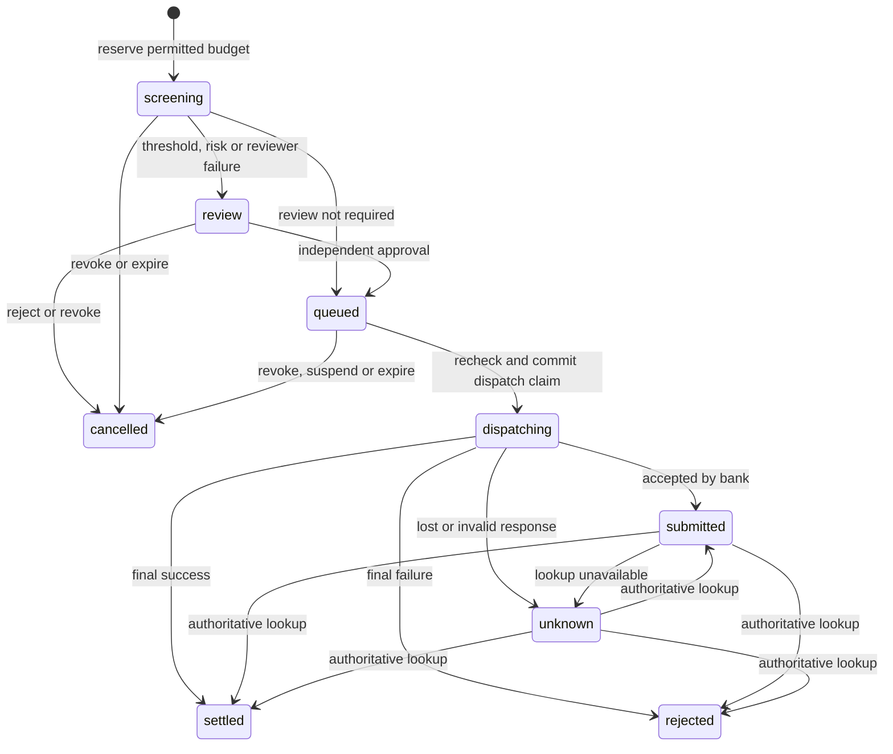

# Architecture

## Trust boundaries

The API controls identity, consent and the queue. The supervisor can request review but has no execution tool. The worker can submit a queued instruction only after rechecking active authority. The bank gateway applies the institution's existing checks and payment semantics. The operator console calls the same role-protected API as other approved applications.

The service is one logical installation with tenant-scoped application queries. It uses SQLite transactions for reservations and work claims. Multiple threads or local processes cannot claim the same queued operation or spend the same delegated budget twice. This is not a distributed database or active-active banking platform.

## Payment lifecycle

Reservations remain consumed while screening, awaiting review, queued, dispatching, submitted or unknown. Settlement permanently consumes that portion of the delegated budget. Cancellation before dispatch and authoritative bank rejection release it exactly once. A new grant is needed to increase a budget; a model or reviewer cannot do that.

The transition to `dispatching` is committed before the network call. It establishes the point after which revocation cannot promise to recall the request. A process crash there becomes an uncertain operation to reconcile, even when it happened before the network call. This sacrifices some availability to avoid inventing a safe retry.

Expired or revoked authority is rechecked before dispatch. Expired agent access tokens do not cancel instructions already accepted under a valid grant; grant expiry and revocation still stop undispatched work. A paused tenant blocks new dispatches but keeps reconciliation available.

## AI and independent checks

Rule supervision always preserves the configured review threshold. The optional model reviewer sees bounded numeric context and can escalate. A separate deterministic validation step rejects policy violations before any model call. Model failure requires review. Approval binds to the stored request hash. The reviewer cannot alter the amount, recipient, account or currency.

Independent roles reduce shared authority; they are not a claim that multiple AI models guarantee correctness. In this release the independent approver is a bank-issued reviewer identity, not a second model pretending to be a human reviewer. The bank must govern role assignment and prevent shared staff accounts.

## Evidence

Every accepted state transition and authenticated policy denial records a bounded audit event. Request proofs and secrets are not copied into the ledger. Events are linked with HMAC-SHA-256 using a key stored separately from the database. Application-level triggers reject event edits and deletion. A host/database administrator remains outside this protection boundary.

Verify and export a checkpoint with `scoutbankai audit`. Keep checkpoints in an independently controlled store. Without a trusted external checkpoint, deleting the end of an otherwise valid chain cannot be detected reliably. Recovery must reconcile unresolved bank operations before new submissions resume.

