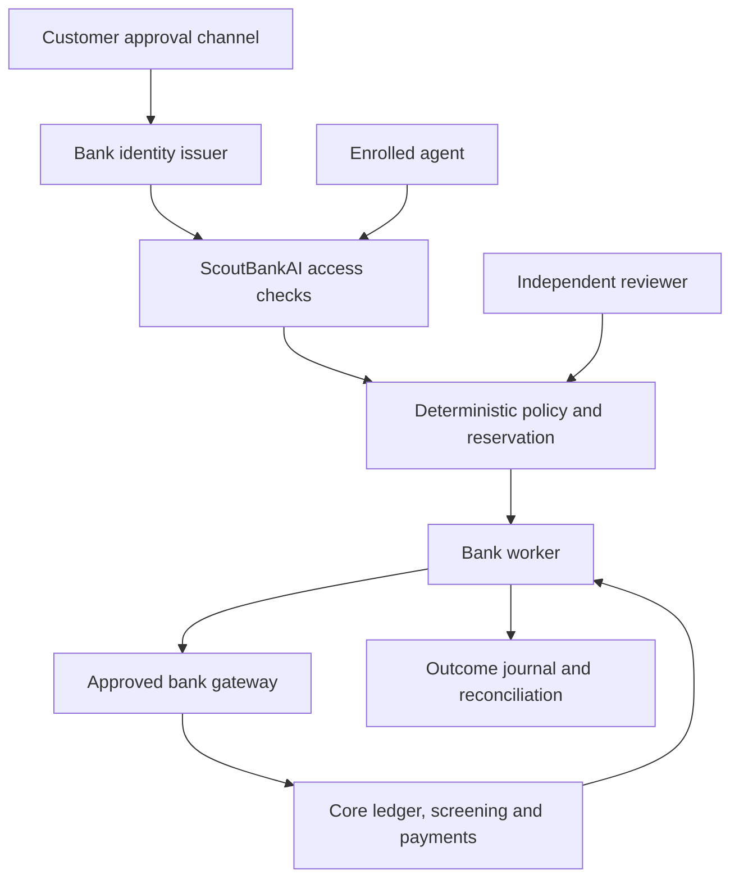

# Banking security review

Reviewed on 27 October 2026. Created and maintained by A Haque (zaid).

## What the public evidence says

| Source | Evidence relevant to this project | Design consequence |
| --- | --- | --- |
| [Reuters, 22 October 2026, syndicated: banks block third-party AI agents](https://www.streetinsider.com/Reuters/US%2Bbanks%2Bdetect%2Bunauthorized%2BAI%2Bagents%2Bin%2Bcustomer%2Baccounts%2C%2BAxios%2Breports/27218068.html) | Reporting describes restrictions on credential-sharing agents. It distinguishes bank permission from customer-supplied credentials and does not establish a universal breach or confirmed customer losses. | Give enrolled agents distinct identities and exact delegated authority. This is news context, not a technical specification or proof that this product solves the reported incidents. |
| [JPMorganChase, 23 March 2026: securing AI agents](https://www.jpmorganchase.com/about/technology/blog/securing-agentic-ai) | The bank calls for execution-time controls, clear authority boundaries and traceable runtime evidence. | Keep hard checks outside model discretion; retain recorded decisions and controlled recovery actions. This is alignment with public guidance, not bank validation. |
| [Bank of England/FCA, 26 October 2026: AI survey](https://www.bankofengland.co.uk/report/2026/artificial-intelligence-in-uk-financial-services-2026) | Respondents report agent adoption with mostly bounded autonomy, and concerns about information security, model-specific risks and external dependencies. | Treat autonomous payment authority cautiously, keep independent approval and measure model/provider behaviour. Survey findings describe respondents, not every bank. |
| [FCA, 19 October 2026, updated 20 October: good practice](https://www.fca.org.uk/publications/good-poor-practice/ai-financial-services) | Guidance discusses structured challenge, outcome monitoring, trained human oversight, evidence and vendor dependency. | Retain audit rounds and independent labels; distinguish tested software behaviour from unmeasured live-model effectiveness. |
| [FSB, 15 October 2026: responsible AI adoption](https://www.fsb.org/2026/10/fsb-finalises-sound-practices-for-the-responsible-adoption-of-artificial-intelligence-ai/) | Sound practices cover governance, lifecycle evaluation, human oversight, cyber risk and third-party dependencies. | Document remaining deployment acceptance work; a repository test result is not institution-wide governance assurance. |
| [JPMorganChase CISO, 26 April 2025: open letter to suppliers](https://www.jpmorganchase.com/about/technology/blog/open-letter-to-our-suppliers) | The bank identifies concentration risk, excessive trust in integrations, token abuse and weakened boundaries between outside services and internal resources. | Restrict the integration surface, require proof-bound authority, preserve separate control and execution paths, and document the shared-host trust boundary. |
| [Monzo engineering, 30 March 2022: securing its banking platform](https://monzo.com/blog/2022/03/31/how-we-secure-monzos-banking-platform) | This historical engineering account describes a distributed, containerised microservices platform. It is evidence that banking architecture is not uniformly an outdated monolith, not verification of Monzo's current configuration. | Integrate with defined bank services instead of assuming all institutions share one architecture or replacing their core ledger. |
| [FCA, 2 September 2026: frontier AI and cyber resilience](https://www.fca.org.uk/publications/multi-firm-reviews/frontier-ai-cyber-resilience) | Reported themes include faster vulnerability discovery, pressure on remediation capacity, access controls, dependency mapping and continuing human oversight. The publication does not introduce new rules. | Test deterministic restrictions and failure paths, audit dependencies, retain independent control changes and record deployment work still required. |
| [Swift Customer Security Programme v2026](https://www.swift.com/myswift/services/training/swift-training-catalogue/browse-swift-training-catalogue/swift-customer-security-programme-v2026) | Swift's published curriculum covers protected critical systems, reduced attack surface, credential protection, separated privileges, anomaly detection and incident response. | Implement role separation and containment; require the institution's infrastructure protections. This is not Swift certification or a completed CSCF assessment. |
| [Basel Committee: Principles for operational resilience](https://www.bis.org/bcbs/publ/d516.htm) | Resilience concerns delivering critical operations through disruption, including dependencies, incident response and recovery. | Preserve unresolved payment states, avoid blind retry, verify backups and explicitly require recovery-gap reconciliation and bank acceptance. |
| [Cryptography project: authenticated encryption](https://cryptography.io/en/latest/hazmat/primitives/aead/) | AEAD protects confidentiality and authenticated context; nonce reuse under a key is unsafe. | Use the established AESGCM implementation with a fresh nonce, record context and versioned keys. No custom cipher or unbreakability claim. |

These sources informed engineering choices. None is a customer, partner, endorsement or audit of ScoutBankAI. Public descriptions do not reveal a bank's entire private architecture.

## How this fits an existing bank

The core ledger, account system, payment engine, customer channels, identity provider, financial-crime controls and settlement connections remain bank-owned. The diagram is an integration model for this project, not a claim to reproduce any named bank's internal topology.

The hard rules run in ordinary application code and database transactions. An optional AI model can recommend additional review; it receives bounded metadata and has no execution tools. Account-wide restrictions and exact control approvals are independent of its answer. This limits how a bad answer can become an action, without pretending the model itself cannot make mistakes.

## Implemented coverage and remaining work

| Risk area | Implemented through 0.4 | Required in the bank deployment |
| --- | --- | --- |
| Agent identity and authority | Enrolled keys, proof-bound tokens, exact signed consent and strict request validation | Protected identity issuance, secure customer approval and controls for routes outside ScoutBankAI |
| Excessive financial authority | Grant budgets, shared account limits, request expiry, current-policy dispatch checks | Real funds checks, canonical account identifiers, risk appetite and institution-wide exposure |
| Insider or agent control changes | Role checks, two distinct staff identities, exact approval, expiry and version conflicts | Identity governance, staff independence, phishing-resistant authentication and incident procedures |
| Compromised account route | Freeze, suspension, revocation and bank pause; independent reopening | Detection, endpoint containment, credential rotation and SOC response |
| Data disclosure | Authenticated encryption of bank identifiers, bounded model inputs, no browser token persistence | Managed keys if required, encrypted volumes/backups, retention and data protection assessment |
| Payment uncertainty and corruption | Durable state machine, balanced reservation journal, no blind retries, integrity checks | Authoritative bank lookup, independent audit retention and recovery-gap reconstruction |
| Model error or shared blind spots | Independent initial audits, bounded peer checks, retained disagreements and human-labelled points | Held-out live-model evaluations, representative cases and independent ground truth |
| Poor traceability or unsafe rollback | Filtered timeline, exact cancellation before dispatch and newly approved restoration of old account limits | Bank-authorised reversal procedures, protected evidence retention and incident ownership |
| Vulnerable software | Pinned direct dependencies, known-advisory audit and CI tests | Asset inventory, continuous monitoring, patch deployment and independent penetration testing |
| Service availability | Durable single-installation storage and verifiable backups | Capacity testing, service monitoring, redundancy, failover and proved recovery objectives |
| Regulatory banking functions | A controlled integration point only | Licensing, deposits, capital, AML/KYC/sanctions, complaints, reporting and all applicable bank controls |

## Release conclusion

This release is executable software with tested controls. It is not a complete digital bank or a claim that all banking security problems are solved. Production acceptance requires the target bank's environment, owner-approved configuration, independent security review, load and recovery exercises, and validated gateway semantics. No real funds or private bank systems were used in repository verification. A production label cannot replace that evidence.

The practical design is to use AI for bounded review while enforcing permissions and execution in deterministic code. It does not ask one model's confidence or a council's agreement to establish that another model is safe. See [release readiness](release-readiness.md) for the remaining evidence and publication scope.
